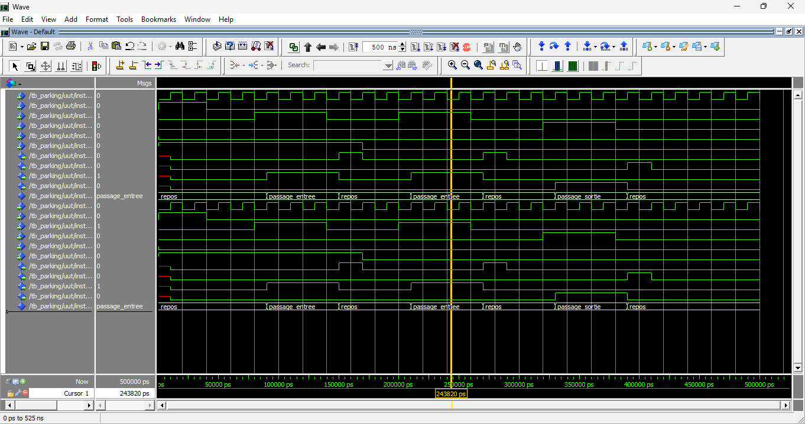

# Smart Parking System Using VHDL

A smart parking system designed in VHDL and simulated with ModelSim. It detects vehicles entering and leaving, counts them, controls the entry/exit barriers and displays the number of occupied spots on a seven-segment display.

## Features
- Vehicle entry and exit detection
- Vehicle counting with capacity control (capacity: 8 spots)
- Parking full and empty indicators
- Entry and exit barrier control
- Seven-segment display output
- VHDL testbench for simulation

## Architecture

The design is split into three modules connected by a structural top level (`parking`).

| Module | File | Role |
|---|---|---|
| `fsm` | `src/fsm.vhd` | Finite state machine controlling the barriers and generating entry/exit events |
| `compteur` | `src/compteur.vhd` | Up/down counter with `plein` / `vide` flags (generic `capacite`) |
| `deco_7seg` | `src/sept_segments.vhd` | Decodes the count (0 to 8) to a seven-segment pattern |
| `parking` | `src/parking.vhd` | Top level that connects the three modules |

### FSM states
- `repos`: waiting for a vehicle. If a vehicle is detected at the entrance and the parking is not full, go to `passage_entree`. If detected at the exit and the parking is not empty, go to `passage_sortie`.
- `passage_entree`: entry barrier open. When the vehicle has passed (sensor back to `0`), pulse `evnt_entree` and return to `repos`.
- `passage_sortie`: exit barrier open. When the vehicle has passed, pulse `evnt_sortie` and return to `repos`.

### Top-level ports

| Port | Direction | Description |
|---|---|---|
| `clk` | in | Clock |
| `reset` | in | Synchronous reset |
| `capteur_entree` | in | Entry sensor |
| `capteur_sortie` | in | Exit sensor |
| `barriere_entree` | out | Entry barrier command |
| `barriere_sortie` | out | Exit barrier command |
| `plein` | out | Parking full |
| `vide` | out | Parking empty |
| `segments` | out | Seven-segment display (7 bits) |

## Project Structure
- `src/`: VHDL design files
- `sim/`: Testbench and simulation files

## Tools Used
- VHDL
- ModelSim

## How to Simulate

Compile in this order (from the repository root), then run the testbench:

```
vlib work
vcom src/sept_segments.vhd
vcom src/compteur.vhd
vcom src/fsm.vhd
vcom src/parking.vhd
vcom sim/testbench.vhd
vsim work.tb_parking
run 500 ns
```

The testbench generates the clock and reset signals and simulates two vehicle entries followed by one exit.

## Simulation Result



The waveform shows the FSM going through `repos` → `passage_entree` → `repos` (twice), then `passage_sortie` → `repos`.

## Known Limitations / Future Improvements
- The testbench is visual only; it does not use `assert` statements yet.
- Full and empty cases are not yet covered by the testbench.
- One-cycle latency between the counter update and the `plein` flag seen by the FSM (edge case with back-to-back vehicles).
- The capacity generic is not exposed at the top level.
